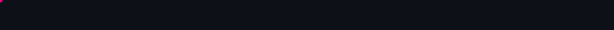
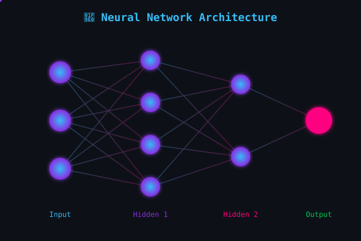

<!-- ═══════════════════════════════════════════════════════════════
     🎨 ULTRA ANIMATED README | Skillyfyzone ML Internship
     Author: AHMAD-0702
     ═══════════════════════════════════════════════════════════════ -->

<!-- ▓▓▓ CUSTOM ANIMATED HEADER SVG ▓▓▓ -->
<div align="center">
  
</div>

<!-- ▓▓▓ ANIMATED TYPING BANNER ▓▓▓ -->
<div align="center">
  <a href="https://git.io/typing-svg">
    
  </a>
</div>

<br/>

<!-- ▓▓▓ STATUS BADGES ▓▓▓ -->
<div align="center">
  
  
  
  
</div>

<div align="center">
  
  
  
  
  
  
</div>

<br/>

<!-- ▓▓▓ CUSTOM WAVE DIVIDER ▓▓▓ -->
<div align="center">
  
</div>

<!-- ▓▓▓ CUSTOM NEURAL NETWORK ANIMATION ▓▓▓ -->
<div align="center">
  
</div>

<br/>

<!-- ▓▓▓ SNAKE ANIMATION ▓▓▓ -->
<div align="center">
  
</div>

<br/>

<!-- ▓▓▓ ANIMATED DIVIDER ▓▓▓ -->


## 📖 Project Overview

<div align="center">
  
</div>

<br/>

<table align="center">
<tr>
<td>

This repository is the **culmination of a remote Machine Learning internship at Skillyfyzone**, containing four progressively challenging tasks that cover the complete ML pipeline — from raw data to deployable models.

My work focused on **hands-on practical learning**, tackling real-world problems through:

</td>
</tr>
</table>

<div align="center">

| 🎯 Focus Area | 💡 What I Did |
| :--- | :--- |
| 🧹 **Data Preprocessing** | Cleaned, normalized & handled missing values in raw datasets |
| 🔧 **Feature Engineering** | Selected & transformed variables for optimal model performance |
| 🤖 **Model Training** | Implemented regression, classification & ensemble algorithms |
| 📊 **Evaluation** | Assessed models using accuracy, precision, recall & F1-score |

</div>

<br/>

<!-- ▓▓▓ CUSTOM ML PIPELINE ANIMATION ▓▓▓ -->
<div align="center">
  
</div>

<br/>

<!-- ▓▓▓ ANIMATED DIVIDER ▓▓▓ -->


## 📂 Repository Structure

<div align="center">
  
</div>

<br/>

| # | 📁 Task Folder | 🎯 Description | 🛠️ Key Skills |
| :-: | :--- | :--- | :--- |
| 01 | **[Task no 01](./Task%20no%2001)** | 🧪 Foundations of ML | Data Cleaning, EDA, Basic Regression |
| 02 | **[Task no 02](./Task%20no%2002)** | 📈 Classification Models | Logistic Regression, Decision Trees, Accuracy |
| 03 | **[Task no 03](./Task%20no%2003)** | ⚡ Advanced Techniques | Ensemble Methods, Hyperparameter Tuning |
| 04 | **[Task no 04](./Task%20no%2004)** | 🚀 Final Project | End-to-End ML Pipeline, Deployment Prep |

<br/>

<!-- ▓▓▓ CUSTOM STATS BARS ANIMATION ▓▓▓ -->
<div align="center">
  
</div>

<br/>

<!-- ▓▓▓ ANIMATED DIVIDER ▓▓▓ -->


## 🛠️ Tech Stack & Tools

<div align="center">

### 👨‍💻 Languages & Libraries


<br/><br/>

### 📊 Data Science Arsenal


</div>

<br/>

<!-- ▓▓▓ ANIMATED DIVIDER ▓▓▓ -->


## 🚀 How to Run Locally

<div align="center">
  
</div>

<br/>

**1️⃣ Clone the repository**
```bash
git clone https://github.com/AHMAD-0702/Skillyfyzone---Intern.git
cd Skillyfyzone---Intern